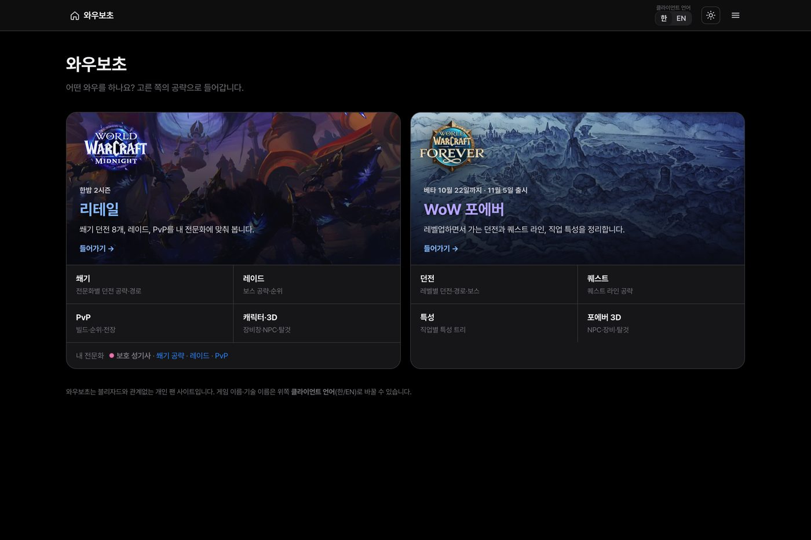
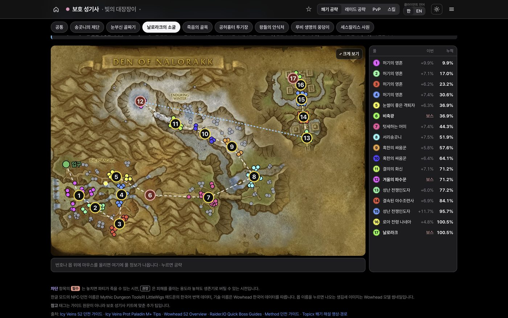
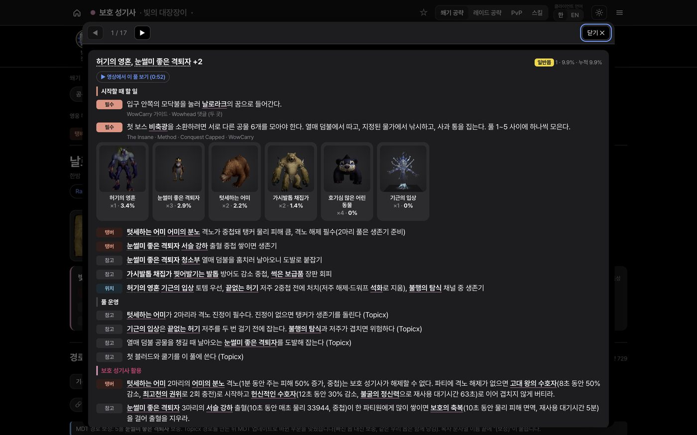
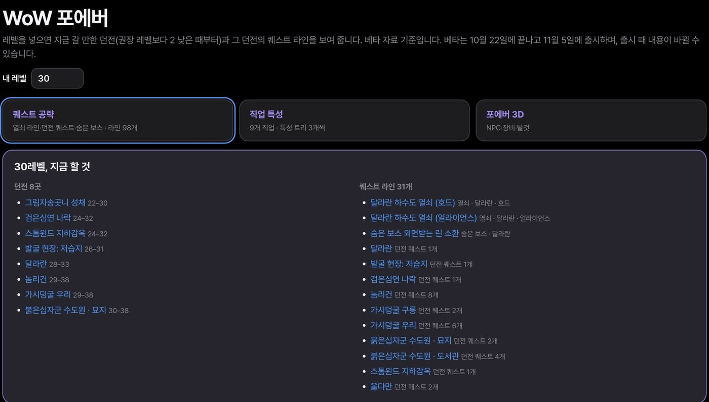
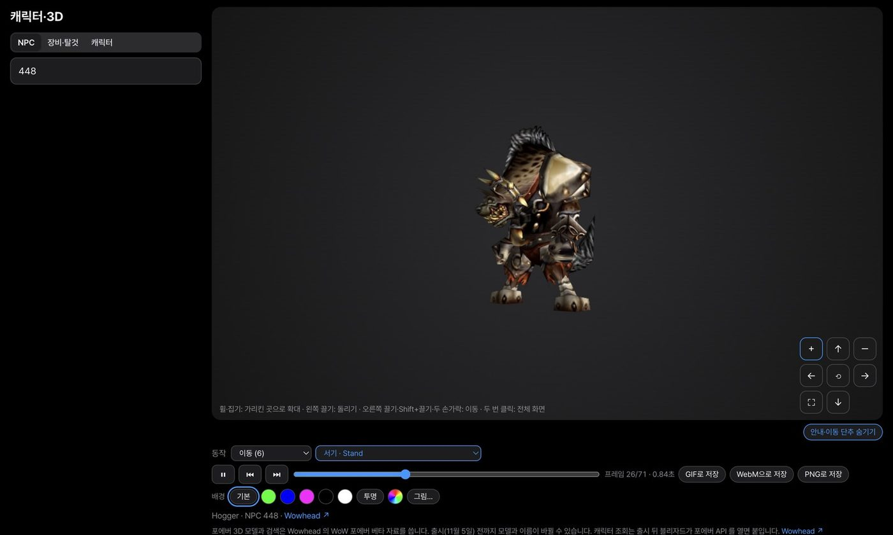

# 와우보초 · WoWBocho

**👉 사이트 바로가기: https://wowbocho.com/**

월드 오브 워크래프트 초보와 복귀 유저를 위한 한국어 공략 사이트입니다. 리테일 한밤(Midnight) 2시즌의 쐐기·레이드·PvP와, WoW 포에버의 던전·퀘스트·특성을 내 직업과 전문화에 맞춰 보여 줍니다. 무료이고 광고와 로그인이 없습니다.

## 리테일 (한밤 2시즌)

- **쐐기 공략:** 던전 8개를 40개 전문화마다 따로 정리했습니다. 경로 지도에서 풀 번호를 누르면 그 풀의 몹 구성, 몹마다 잡몹 %, 역할별·전문화별로 할 일이 나옵니다. 주행 영상의 그 풀 장면으로 바로 갈 수도 있습니다.
- **경로 지도:** 지도 오른쪽에 풀마다 이번 %와 누적 %가 나옵니다. 몹 점에 마우스를 올리면 MDT처럼 어떤 몹인지와 잡몹 %가 보입니다. MDT 문자열을 붙여 넣으면 내 경로로도 그려 줍니다.
- **레이드·PvP:** 보스 공략과 전문화 순위, PvP 빌드를 정리했습니다.

## WoW 포에버

- 레벨을 넣으면 지금 갈 던전과 이어지는 퀘스트 라인을 보여 줍니다.
- 던전 30곳의 지도·보스 공략, 퀘스트 98라인, 9개 직업 특성 계산기가 있습니다.

## 3D 보기

NPC·장비·탈것을 한글이나 영문 이름으로 찾아 3D로 보고, 동작을 고르고, GIF·PNG로 저장할 수 있습니다.

## 안내

- 이 저장소에는 소개 글만 있습니다. 사이트 코드는 공개하지 않습니다.
- 와우보초는 블리자드와 관계없는 개인 팬 사이트입니다. World of Warcraft와 관련 이름·그림의 권리는 Blizzard Entertainment에 있습니다.
- 틀린 곳이나 바라는 기능은 [인벤 소개 글](https://www.inven.co.kr/board/wow/17/41308) 댓글로 알려 주세요.

---

**English:** WoWBocho is a free Korean/English guide site for World of Warcraft — Midnight Season 2 Mythic+ routes per spec (pull-by-pull maps, MDT-style forces %, run-video timestamps), raid and PvP, plus WoW Forever dungeons, quests and talent calculators, and a 3D model viewer. Visit **https://wowbocho.com/?ui=en**. This repository only holds this introduction; the site source is private. Fan site, not affiliated with Blizzard Entertainment.
